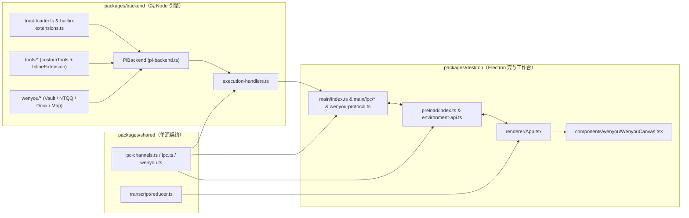

# Percho 底座源码勘察与 Wenyou Pro 文游改造地图

> 勘察整理：安钰｜底座上游：`Jaxton07/percho`（MIT License，保留上游 `LICENSE` 版权声明）｜SDK 基线：`@earendil-works/pi-coding-agent` / `@earendil-works/pi-ai` / `Electron`

---

## 0. 基线集成概况

1. **上游落位与版权保留**：
   - 基于 `Jaxton07/percho`（MIT）演进为四包 monorepo（`packages/shared`、`packages/backend`、`packages/desktop`、`packages/pixi-sandbox`），完整保留根目录上游 `LICENSE`（`MIT License, Copyright (c) 2026 Jaxton07`）。
   - 脱敏演示战役位于 `fixtures/demo-campaign/`；根 `.gitignore` 忽略本地临时归档与打包输出目录。
2. **依赖与瘦身边界**：
   - `packages/desktop/package.json` 的生产 `dependencies` 仅保留主进程运行期所需的 5 个包（`@earendil-works/pi-ai`、`@earendil-works/pi-coding-agent`、`@percho/backend`、`@percho/shared`、`electron-updater`），纯前端依赖放至 `devDependencies` 由 Vite 静态打包。
   - 移除上游面向编程 IDE 的重型/非文游组件（UI 插件运行时、LAN 观察端、SSH 远端界面、Monaco 代码查看器、Mermaid、KaTeX、Shiki 与 Diff 侧栏），打包钩子 `packages/desktop/scripts/after-pack.cjs` 裁剪 `locales/` 仅留 `zh-CN.pak` 与 `en-US.pak`。

---

## 1. 模块总览与改造全景

四包采用严格单向分层（无循环依赖）：
- `packages/shared`：纯跨进程契约、IPC 单一事实源表、Transcript 纯函数 reducer、文游领域类型（零 Electron/React 依赖）。
- `packages/backend`：纯 Node 的 pi SDK 门面（`PiBackend`）、内置工具与文游内联扩展、权限门控、模型/登录配置与会话目录索引。
- `packages/desktop`：Electron 主进程（装配 `PiBackend` + IPC 注册 + 特权协议 + 窗口管理）、Preload（基于共享表自动派生 `window.pi`）、Renderer（React 19 + Tailwind CSS v4 + Zustand + Lexical + 文游四页签工作台）。
- `packages/pixi-sandbox`：独立构建并离线内嵌的 Pixi.js 8 动态战略/战役/野战沙盘。

---

## 2. 内置扩展、工具、Skills 与 System Prompt 注入机制

### 2.1 核心源码定位

| 机制 | 源码位置 | 关键行为与约束 |
| :--- | :--- | :--- |
| 官方内置扩展注册 | `packages/backend/src/project/builtin-extensions.ts` | 返回内置 `InlineExtension`（其中 `codemode` 默认关闭）。 |
| 扩展加载优先级（先注册者赢） | `packages/backend/src/project/trust-loader.ts` | `composeExtensionFactories(ours, deps)` 将自研扩展排在官方内置扩展**之前**，确保文游工具与扩展优先注册。 |
| 两阶段项目资源加载 + Prompt/Skill 注入 | `packages/backend/src/project/trust-loader.ts` | `ProjectResourceLoader.load()` 创建 `DefaultResourceLoader`：注入全部内联扩展、`additionalSkillPaths`（指向 `packages/desktop/resources/wenyou-skills/`）与 `appendSystemPromptOverride`。 |
| 桌面端 Prompt 与随包 Skill 装配入口 | `packages/desktop/src/main/index.ts` | 构造 `new PiBackend({ desktopIntegration: { appendSystemPrompt, additionalSkillPaths } })`，随包技能随 `extraResources` 打包。 |
| 自研内置工具装配 | `packages/backend/src/pi-backend.ts` | `buildCustomTools()` 合并内置工具（`webfetch`、`show_image`、`todo`、`subagent`）并透传给 `createAgentSession`。 |
| 自定义子代理发现机制 | `packages/backend/src/tools/subagent/agents.ts` | `discoverAgents()` 仅发现用户目录与受信项目目录中的 `.md` 子代理，不内置硬编码通用或文游子代理。 |

### 2.2 工具结果推送前端与触发右侧画布更新的两条链路

1. **链路 A：依托 `tool_execution_end` 的 `result.details`（可随会话 JSONL 持久化与历史回放）**
   - `packages/backend/src/session/event-slim.ts` 保留 `details` 原样透传，供历史会话回看工具结果卡片。
2. **链路 B：内联扩展回调 → `PiBackend` 专用 `Emitter` → `wenyou:canvasEvent` 订阅通道**
   - Agent 调用文游工具（发布简报、写入 `.docx` 国策、打开/查看沙盘与图集等）时，即时向前端推送 `WenyouCanvasEvent`，驱动右侧 `WenyouCanvas` 展开并聚焦对应页签或证据条目。

### 2.3 Wenyou Pro 文游扩展与随包技能

- **内置文游扩展 `makeWenyouExtension`（`packages/backend/src/wenyou/extension.ts`）**：
  - `on("context_with_system")`：当工作区存在 `manifest.json` 时注入当前世界标题、纪年与目录概览。
  - 注册 8 个文游专职工具：`wenyou_init_campaign`、`wenyou_pull_qq`、`wenyou_lookup_source`、`wenyou_read_memory`、`wenyou_publish_briefing`、`wenyou_write_policy_docx`、`wenyou_open_maps`、`wenyou_inspect_map`。
  - 工作区路径边界由 `packages/backend/src/wenyou/vault-paths.ts` 统一保护（规范化与 `realpath` 防路径穿越），不设阻断 Agent 正常读写工作区文件的 `tool_call` 拦截钩子。
- **随包文游技能（`packages/desktop/resources/wenyou-skills/`）**：
  - `wenyou-handwritten-policy/SKILL.md`：自然段宋体国策书案软性写作引导。
  - `wenyou-situation-memory/SKILL.md`：多群防重报采集与 L0/L1/L2 三层局势记忆维护指南。

---

## 3. 共享 IPC 契约层（单源表驱动扩展规范）

1. **Invoke 通道表（`packages/shared/src/ipc-channels.ts`）**：
   - `WENYOU_CHANNELS`（`scope: "environment"`）：`wenyouGetOverview`、`wenyouInitCampaign`、`wenyouPullQq`、`wenyouLookupSource`、`wenyouListBriefings`、`wenyouPublishBriefing`、`wenyouListPolicies`、`wenyouWritePolicyDocx`、`wenyouReadCanonDoc`、`wenyouListMaps`、`wenyouInspectMap`、`wenyouSaveMapSnapshot`、`wenyouNtqqStatus`、`wenyouNtqqExtractKey`、`wenyouNtqqListGroups`、`wenyouNtqqBindGroups`、`wenyouNtqqPull`。
   - `WENYOU_DESKTOP_CHANNELS`（`scope: "desktop"`）：本机对话框、`.docx` 另存为、资源定位、沙盘探测与空白世界创建。
2. **Main → Renderer 订阅表（`SUBSCRIPTION_TABLE`）**：
   - `onWenyouCanvasEvent`（`wenyou:canvasEvent`）经 `main/ipc/send.ts` 与 `forward(...)` 类型安全转发至渲染进程。
3. **注册位置**：
   - `packages/backend/src/execution-handlers.ts` 实现 `WENYOU_CHANNELS`；
   - `packages/desktop/src/main/ipc/wenyou.ts` 装配 `WENYOU_CHANNELS` 与 `WENYOU_DESKTOP_CHANNELS`。

---

## 4. 桌面端 Renderer 布局与「文游动态画布」

### 4.1 主窗口布局

- 顶栏 `SessionTabBar` + 左侧项目/世界栏 `Sidebar`（含 `ProjectPicker` 切换/新建空白世界）+ 中间对话列（`EmptyState` 四大文游任务快捷卡片 + `MessageList` + `Composer`）+ 右侧并排可拖拽分屏 `<WenyouCanvas />`。
- 文游动态画布作为一等内置组件位于 `packages/desktop/src/renderer/src/components/wenyou/`，状态由 `stores/wenyou-canvas.ts` 管理。

### 4.2 右侧画布四大核心页签

1. **Tab 1 — 局势简报（`BriefingPanel.tsx` + `SourceContextDrawer.tsx`）**：展示三段式 L1 局势简报与跨群滚动台账，点击 `[sourceId]` 展开 L0 原群聊上下文溯源抽屉（支持 ±30 / ±100 / ±300 / ±1000 及首尾翻页）。
2. **Tab 2 — 国策书案（`PolicyDeskPanel.tsx`）**：以宋体纸面样式只读预览 `03-国策与文书/` 中已归档国策，支持 `.docx` 另存为、打开所在文件夹及一键向聊天框派发起草指令。
3. **Tab 3 — 沙盘与图集（`AtlasComparePanel.tsx`）**：通过 `wenyou-sandbox://`（或开发态 `http(s)://` 地址）与 `?workspace=<cwd>` 隔离参数挂载内置 Pixi 沙盘，双向同步工程存档，并提供基于 `wenyou-asset://vault` 协议的高清双期态势图单图/双屏/卷帘缩放对比。
4. **Tab 4 — 设定与编年史（`ProposalsExportPanel.tsx`）**：纯只读浏览 `01-设定与国力实册/` 与 `04-编年史与条约/` 文档目录与正文内容。

---

## 5. 模型、订阅 OAuth 与数据目录隔离

1. **多通道模型配置**：直接复用 Percho 与 Pi SDK 的内置 Provider、OAuth 登录、Base URL 中转站覆写及自定义 Provider 上游 `/models` 探测能力（`packages/backend/src/settings/` 与 `components/settings/providers/`）。
2. **数据与品牌隔离**：
   - `packages/desktop/build/app-channels.json` 与 `packages/desktop/src/main/app-identity.ts` 确立 `Wenyou Pro` 独立应用身份与 `userData` 目录；
   - `packages/backend/src/storage/path-policy.ts` 与 `packages/desktop/src/main/dev-agent-dir.ts` 将运行数据隔离至 `~/.wenyou-pro/agent[-dev|-beta]`，默认世界根目录为 `~/.wenyou-pro/worlds/`，不与原装 Percho 或其他 CLI 串数据。
