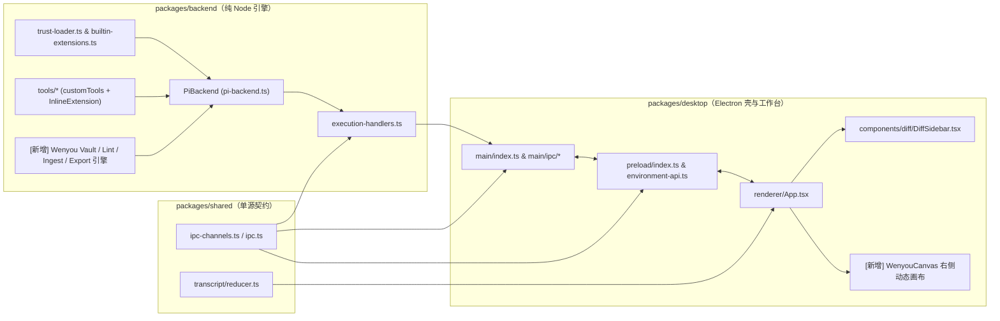

# Percho 底座源码勘察与 Wenyou Pro 文游改造地图

> 勘察整理：安钰｜底座上游：`Jaxton07/percho`（MIT License，保留上游 `LICENSE` 版权声明）｜SDK 基线：`@earendil-works/pi-coding-agent@1.5.1` / `@earendil-works/pi-ai@1.5.1` / `Electron 43.3.0`

---

## 0. 基线集成与编译核验结果

1. **目录无损归档与上游落位**：
   - Stage 0 原工程（`apps/`、`packages/`、`tools/`、`node_modules/`、`package.json`、`package-lock.json`、`tsconfig.base.json`、`ACCEPTANCE.md`、`ARCHITECTURE.md`、`AGENTS.md` → `AGENTS.stage0.md` 等）已无损移入 `_legacy_stage0_backup/`。
   - 原有 `docs/` 与 `fixtures/golden-vault/` 保持原位；上游 `docs/` 参考文档已无冲突并入 `docs/`；根 `.gitignore` 已忽略 `/_legacy_stage0_backup` 与 `/.percho-clone-staging`。
   - 根目录完整保留上游 `LICENSE`（`MIT License, Copyright (c) 2026 Jaxton07`）。
2. **本机依赖安装与基线编译**：
   - 运行环境：`Node v24.22.1`（满足 `engines.node >= 22.19`）、`npm 11.19.1`。
   - 执行 `ELECTRON_MIRROR=https://npmmirror.com/mirrors/electron/ npm install` 成功（804 packages，`patch-package` 自动应用 `@earendil-works/pi-agent-core@1.5.1`、`@earendil-works/pi-coding-agent@1.5.1`、`thinking-orbs@0.3.1` 补丁，Electron 43.3.0 二进制安装成功）。
   - 执行 `npm run typecheck` 全工作区零报错通过：`@percho/shared`、`@percho/backend`、`@percho/desktop`（`tsconfig.node.json` + `tsconfig.web.json`）均 **0 error**。

---

## 1. 模块总览与改造全景

Percho 采用清晰的三包单向分层（不依赖环）：
- `packages/shared`：纯跨进程契约、IPC 单一事实源表、Transcript 纯函数 reducer、模型可见性与展示类型（零 Electron/React 依赖）。
- `packages/backend`：纯 Node 的 pi SDK 门面（`PiBackend`）、内置工具与内联扩展、权限门控、模型/登录配置与会话目录索引。
- `packages/desktop`：Electron 主进程（装配 `PiBackend` + IPC 注册 + 窗口管理）、Preload（基于共享表自动派生 `window.pi`）、Renderer（React 19 + Tailwind CSS v4 + Zustand + Lexical + Monaco）。

> **资产复用策略**：`_legacy_stage0_backup/packages/` 中已经过单元测试与黄金夹具验证的纯 TS 领域内核（`contracts`、`vault-core`、`map-bridge`、`qq-ingest`、`export-pack`）可直接迁入新工作区（如 `packages/wenyou-core` 或拆包挂入根 `workspaces: ["packages/*"]`），由 `packages/backend` 消费并向 Agent 工具与桌面 IPC 双路暴露，实现零重复造轮子。

---

## 2. 内置扩展、工具、Skills 与 System Prompt 注入机制

### 2.1 核心源码定位（已核实精确行号）

| 机制 | 源码位置 | 关键行为与约束 |
| :--- | :--- | :--- |
| 官方内置扩展注册 | `packages/backend/src/project/builtin-extensions.ts:19-42` | `builtinExtensions(deps)` 返回 `codemode`、`tool-search`、`mcp` 三个 `InlineExtension`，均标记 `builtin: true, replaceable: true`。 |
| 扩展加载优先级（先注册者赢） | `packages/backend/src/project/trust-loader.ts:19-27` | `composeExtensionFactories(ours, deps)` 将 Percho 自研扩展排在官方内置扩展**之前**；不标 `replaceable`，确保自研工具/钩子优先于官方与第三方扩展。 |
| 两阶段项目资源加载 + Prompt/Skill 注入 | `packages/backend/src/project/trust-loader.ts:41-122` | `ProjectResourceLoader.load()` 创建 `DefaultResourceLoader`（`82-99`）：通过 `extensionFactories` 注入全部内联扩展、`additionalSkillPaths` 注入随包 Skills 目录、`appendSystemPromptOverride: (base) => [...desktopPrompt, ...base]` 在保留 SDK `APPEND_SYSTEM.md` 发现机制的前提下前置追加桌面端提示段落。 |
| 桌面端 Prompt 与随包 Skill 装配入口 | `packages/desktop/src/main/index.ts:30-35, 70-84` | 构造 `new PiBackend({ desktopIntegration: { appendSystemPrompt, additionalSkillPaths } })`。当前随包 Skill 位于 `packages/desktop/resources/ui-plugins/skills/`（通过 `electron-builder.yml:41-42` 随 `extraResources` 打包）。 |
| 自研内置工具装配 | `packages/backend/src/pi-backend.ts:962-1013` | `buildCustomTools()` 合并 `options.customTools` + `makeWebFetchTool` + `makeShowImageTool` + `makeTodoTool` + `makeSubagentTool`，在 `createSession`（`1494-1510`）与 `openSessionOnce`（`1612-1627`）透传给 `createAgentSession({ customTools, resourceLoader })`。 |
| 内联扩展链顺序 | `packages/backend/src/pi-backend.ts:1036-1122` | `buildExtensionFactories()` 按序装配：`input` 停机守卫 → `makePermissionGateExtension` → `makeEvapExtension`（上下文蒸发）→ `makeCompactionGuardExtension` → `makeChannelsExtension` → `makeTodoReminderExtension`。顺序即 `context` 钩子执行序。 |
| 工具定义标准范式 | `packages/backend/src/tools/show-image.ts:69-134` `packages/backend/src/tools/todo.ts:52-79` | 使用 SDK 的 `defineTool({ name, label, annotations, description, promptSnippet, promptGuidelines?, parameters: Type.Object(...), execute })`。`execute` 返回 `AgentToolResult<TDetails>`，其中 `content` 喂给模型，`details` 仅供 UI/宿主消费（模型不可见）。 |
| 内联扩展 + 实时状态推送范式 | `packages/backend/src/tools/channels/extension.ts:20-126` | 完整演示了 `InlineExtension` 写法：`pi.registerTool(...)` 注册一组领域工具，监听 `session_start` / `session_shutdown` / `context_with_system`（`97-123` 可动态向模型注入隐式上下文 `display: false`），并通过 `onSnapshot` 回调把结构化状态经 `PiBackend` 的 `Emitter` 实时推送给前端。 |
| 权限放行与路径边界 | `packages/backend/src/permissions/annotations.ts:38-49` `packages/backend/src/permissions/extension.ts:24-27, 77-160` | `isTrustedBuiltinTool` 对宿主注册的 `customTools`（`<sdk:…>`）和内联扩展（`<inline:…>`）直接判定为受信内置，跳过 MCP 非受信弹窗；默认规则 `permissions/config.ts:37` 为 `"*": "allow"`。若文游工具涉及**正式写入正史 Vault 文件**，应在工具内强制走提案审批或显式加入 `WRITE_TOOLS` / 规则确认。 |
| 内置子代理发现机制 | `packages/backend/src/tools/subagent/agents.ts:34-40, 160-172` | `discoverAgents()` 按 `BUILTIN_WORKER` → `~/.percho/agent/agents/*.md` → 受信项目 `.pi/agents/*.md` 发现子代理。可直接在此新增内置文游专职子代理（`ingest-triage`、`policy-auditor`、`chronicle-scribe`、`faction-advisor`），自动出现在「设置 → 模型 → 子代理」中支持独立指定模型与思考深度！ |
| SDK 扩展类型基线 | `node_modules/@earendil-works/pi-coding-agent/dist/core/extensions/types.d.ts:420-554, 1230-1580` | `ToolDefinition` 支持 `promptSnippet`、`promptGuidelines`、`outputSchema`、`annotations`、`executionMode`；`ExtensionAPI` 支持 `registerTool`、`registerCommand`、`on("before_agent_start" \| "context_with_system" \| "tool_call" \| "tool_result")`、`sendMessage`、`appendEntry`、`events`。 |

### 2.2 工具结果推送前端与触发右侧画布更新的两条链路

Percho 源码中存在两条经过验证的「后端工具 → 前端 UI」数据通道（可组合使用）：

1. **链路 A：依托 `tool_execution_end` 的 `result.details`（可随会话 JSONL 持久化与历史回放）**
   - **安全保障**：`packages/backend/src/session/event-slim.ts:54-90` 的 `slimBulkyEvent()` 会截断超长 `content[].text` 并剥除 `content[].image`，但**第 62 行明文承诺 `details` 一律原样保留**（`show_image`、`todo`、`edit` patch、`subagent` 均走此通道）。
   - **实时路径**：`PiBackend.emitEvent`（`pi-backend.ts:1376-1440`）→ `main/ipc/index.ts:106-117` 推 `pi:event` → `renderer/src/hooks/use-session-event-bridge.ts:27-51` → `packages/shared/src/transcript/reducer.ts:503-586`（`tool_execution_end`）。
   - **历史回放路径**：`packages/backend/src/session/messages.ts:344-384` 读取 JSONL 中 `toolResult.details` 还原为独立消息或工具附加字段。
   - **适用场景**：Agent 产出的「国策体检报告卡」「待审 Diff 提案卡」「地图高亮标注卡」——既能在流式结束瞬间触发 `useWenyouCanvasStore` 切到对应标签并聚焦，也能在重开历史会话时从聊天流点击回看。
2. **链路 B：内联扩展回调 → `PiBackend` 专用 `Emitter` → 独立订阅通道（瞬时态/画布指令，不污染会话 JSONL）**
   - **参照实现**：`makeChannelsExtension` 的 `onSnapshot`（`pi-backend.ts:1105-1111`）→ `ChannelSubscriptionRegistry` → `main/ipc/index.ts:131` `forward(..., IpcChannels.ChannelSubscriptionsChanged)` → Renderer store 订阅。
   - **适用场景**：Agent 调用 `wenyou_open_canvas({ tab, targetId, sourceId })` / `wenyou_propose_patch(...)` / `wenyou_focus_map(...)` 时，立即向前端推送 `wenyou:canvasEvent`（或 `wenyou:vaultChanged`），打开右侧画布、滚动到对应 `sourceId` 群聊原文或刷新待审提案列表。

### 2.3 Wenyou Pro 建议注入的内置扩展、工具与 Skills

- **内置文游扩展 `makeWenyouExtension`（挂载于 `pi-backend.ts:1036` `buildExtensionFactories`）**：
  - `on("context_with_system")`：当当前项目目录包含 `manifest.json`（识别为文游 Vault）时，按当前会话绑定的 `ViewerScope`（`gm` / `public` / `faction:<id>`）自动注入精简的世界态势头（当前轮次、活跃支线、视角隔离硬约束），绝不向非 GM 视角泄露 `private/` 内容。
  - `on("tool_call")`：作为 `permission-gate` 前置硬红线，当 `maxViewer !== "gm"` 时，物理阻断 `read` / `grep` / `find` / `ls` / `bash` 访问 `<vault>/private/` 或跨阵营密档，且禁止 `edit` / `write` 直接覆写受保护的正史目录（强制走提案审批）。
  - 注册一组文游专职工具（命名空间 `wenyou_*`，标注 `annotations` 与 `promptSnippet`）：
    - 只读类：`wenyou_vault_query`（视角裁剪检索编年史/词条/条约）、`wenyou_source_lookup`（按 `sourceId` 查原群聊上下文）、`wenyou_policy_lint`（零 LLM 静态体检穿帮/透题/套话）、`wenyou_export_preflight`（发包泄密预检）。
    - 提案/画布类：`wenyou_propose_patch`（提交结构化 `DiffPatchProposal` 入待审队列并推画布）、`wenyou_canvas_focus`（驱动右侧画布切换局势书/书案/高清地图比对/沙盘定位）、`wenyou_draft_docx`（生成国策/公告 `.docx` 草稿并打开书案预览）。
- **随包文游 Skills 与提示词（挂载于 `main/index.ts:75-83` `desktopIntegration`）**：
  - 在 `packages/desktop/resources/wenyou-skills/` 下随包分发四大标准 SOP 技能（`wenyou-ingest-triage`、`wenyou-policy-audit`、`wenyou-chronicle-draft`、`wenyou-faction-advisor`），通过 `additionalSkillPaths` 传入（同步加入 `electron-builder.yml` `extraResources`），并在 `appendSystemPrompt` 中追加简明文游工作台身份与「提案权 vs 落锤权」红线。

---

## 3. 共享 IPC 契约层（单源表驱动扩展规范）

### 3.1 单一事实源结构（`packages/shared/src/ipc-channels.ts`）

Percho 的 IPC 完全由两张常量表驱动，**禁止散落手写通道字符串或绕过载荷类型检查**：

1. **Invoke 通道表**：
   - 构造原语：`ch(channel, scope, operation)<Args, Ret>(rules)`（`ipc-channels.ts:105-145`）。
   - `scope` 分为两类：
     - `"desktop"`：仅本机桌面拥有（文件/目录弹窗、窗口、主题、UI 状态、LAN、UI 插件），直接挂在 `window.pi.<method>`（`preload/index.ts:9-13`）。
     - `"environment"`：绑定执行环境（本机或 SSH 远端），强制要求传入 `input.*` 运行时参数校验规则（`request-validation.ts`），仅经 `window.pi.forEnvironment(env).<method>` 访问（`preload/environment-api.ts:25-35`），由 `main/environment-router.ts:40-57` 做校验与路由。
   - 汇总表：`CHANNEL_TABLE`（`ipc-channels.ts:1087-1098`），派生 `InvokeApi<T>` / `InvokeHandlers<T>`（`1103-1114`）以及 `EnvironmentHandlers` / `EnvironmentApi` / `DesktopApi` / `PiApi`（`packages/shared/src/ipc.ts:28-72`）。
2. **Main → Renderer 订阅表**：
   - 构造原语：`subscription<Payload, Scope>(scope)(alias, channel)`（`ipc-channels.ts:1126-1139`）。
   - 汇总表：`SUBSCRIPTION_TABLE`（`1142-1192`），自动派生 `SubscriptionApi`、`SubscriptionChannel`、`SubscriptionPayload<C>` 与 `IpcChannels` 冻结常量（`1194-1214`）。
   - Main 侧发送一律经 `packages/desktop/src/main/ipc/send.ts:12-37` 的 `sendToRenderer(channel, payload)` 或 `forward(subscribeFn, channel)`，享受编译期载荷类型校验。

### 3.2 新增 `wenyou:*` IPC 通道的标准注册步骤

按通道归属选择对应作用域：

#### 方案 1：桌面本机独占通道（`scope: "desktop"`）
适用于：导出 `.docx` / 离线 HTML 保存对话框、本机高清地图读取/图片缩放源协议、本机 `wenyou-pixi-app` 端口/桥接配置、文游画布持久化偏好。
1. **`packages/shared/src/wenyou.ts`**（新建）：定义请求/响应与事件载荷类型。
2. **`packages/shared/src/ipc-channels.ts`**：
   - 新增 `export const WENYOU_DESKTOP_CHANNELS = { ... } as const;`（使用 `ch("wenyou:...", "desktop", "read" | "mutation")<Args, Ret>()`）。
   - 展开进 `CHANNEL_TABLE`（`1087-1098`）。
   - 如需推送事件，在 `SUBSCRIPTION_TABLE`（`1142-1192`）追加 `onWenyouCanvasEvent: subscription<WenyouCanvasEvent, "desktop">("desktop")("WenyouCanvasEvent", "wenyou:canvasEvent")`。
3. **`packages/shared/src/ipc.ts` & `packages/shared/src/index.ts`**：重导出 `WENYOU_DESKTOP_CHANNELS` 与新增类型。
4. **`packages/desktop/src/main/ipc/wenyou.ts`**（新建）：参照 `main/ipc/ui-plugins.ts:19-75`，调用 `registerInvokeHandlers(WENYOU_DESKTOP_CHANNELS, { ... })` 实现。
5. **`packages/desktop/src/main/ipc/index.ts`**：调用 `registerWenyouIpc(...)`，并在需要时用 `forward(...)` 转发订阅事件。
6. **Preload 零改动**：`preload/index.ts` 自动遍历 `CHANNEL_TABLE` / `SUBSCRIPTION_TABLE` 暴露至 `window.pi`。Renderer 直接调用 `getPi().wenyouXxx(...)`。

#### 方案 2：环境执行通道（`scope: "environment"`，推荐用于全部 Vault 业务操作）
适用于：加载 Vault 目录与索引、切换/钳制 `ViewerScope`、查询 `sourceId` 原群聊上下文、运行静态国策体检、读取/批准/驳回 `DiffPatchProposal`、发包泄密预检（天然兼容本机与 SSH 远端工作区）。
1. **`packages/shared/src/ipc-channels.ts`**：新增 `WENYOU_CHANNELS`，每条使用 `ch("wenyou:...", "environment", "read" | "mutation")<Args, Ret>({ ...inputRules })` 并展开进 `CHANNEL_TABLE`；订阅事件在 `SUBSCRIPTION_TABLE` 使用默认 `"environment"` scope。
2. **`packages/shared/src/ipc.ts` & `index.ts`**：重导出。
3. **`packages/backend/src/pi-backend.ts`（或拆分 `packages/backend/src/wenyou/` 服务挂到 `PiBackend`）**：实现具体业务方法与 `Emitter`。
4. **`packages/backend/src/execution-handlers.ts:11-143`**：在 `createExecutionHandlers(backend)` 中补齐对应方法（`EnvironmentHandlers` 类型强制穷尽校验，漏写直接编译报错）。
5. **`packages/backend/src/runtime/events.ts:7-35`**（若新增了 `"environment"` 订阅）：在 `bindExecutionEvents` 中补齐订阅转发（`Pick<EnvironmentApi, EventMethod>` 同样编译期强制穷尽）。
6. **`packages/desktop/src/main/ipc/wenyou.ts` + `main/ipc/index.ts`**：用 `registerInvokeHandlers(WENYOU_CHANNELS, createExecutionHandlers(backend))` 注册，并用 `forward(...)` 转发事件。
7. **Renderer 调用**：经 `getExecutionApi(cwdOrSessionId).wenyouXxx(...)` 自动附带环境信封并路由。

---

## 4. 桌面端 Renderer 布局、右侧栏机制与「文游动态画布」挂载方案

### 4.1 现有主窗口骨架与核心组件定位

| 区域 | 核心源码与行号 | 现状机制与改造点 |
| :--- | :--- | :--- |
| 根装配与主壳布局 | `packages/desktop/src/renderer/src/workbench.tsx:16-36` `packages/desktop/src/renderer/src/App.tsx:142-200` | 垂直两段：`SessionTabBar`（顶栏 `h-12`）+ `
` 横向容器，内含 `<Sidebar />` + 中间聊天列（`data-session-page`）+ `<DiffSidebar />`。 |
| 顶栏 | `packages/desktop/src/renderer/src/components/session/SessionTabBar.tsx:234-477` | `pl-3 pr-[140px]`（Windows 系统按钮留白，`346-347`）；左端左栏开合按钮（`354-365`）；中间可拖拽会话胶囊（`367-431`）；右端依次是更新按钮、新会话 `+`、`DiffSidebar` 开关（`448-458`，`data-diff-toggle`）。**改造点**：在 `data-diff-toggle` 左侧增加「文游画布」开关按钮 + 当前 `ViewerScope` 视角徽章（GM / 公开 / 阵营）。 |
| 左侧项目/会话栏 | `packages/desktop/src/renderer/src/components/sidebar/Sidebar.tsx:30-150` `SidebarHeader.tsx:11-45`、`ProjectSection.tsx:17-174`、`SidebarFooter.tsx:9-24` 样式：`styles/globals.css:1501-1595` | Flex push 布局（`width: var(--sidebar-render-width)` + 右缘 `SidebarResizeHandle` 拖拽调宽 + `is-collapsed` 宽归 0）。项目分组天然对应「文游世界库（Vault）」；`ProjectSection` 可识别目录下 `manifest.json` 显示世界标题与当前轮次，并提供「新建/导入文游世界」入口。 |
| 聊天空态与快捷启动 | `packages/desktop/src/renderer/src/components/chat/EmptyState.tsx:8-30` `components/session/ProjectBranchPicker.tsx:18-238` `i18n/zh.ts:14-16` | 当前仅显示 `Percho` 品牌词 + `emptyState.slogan` + `<Composer centered />` + `<ProjectBranchPicker />`。**改造点**：保留极简居中感，品牌文案切换为 Wenyou Pro；在 `ProjectBranchPicker` 下方增加 4 张轻量化「文游任务快捷启动卡片」（洗群聊提证据 / 审国策核旧账 / 写结算与演化档案 / 阵营参谋写国策），点击直接写入对应 Skill 指令/草稿模板并打开对应画布标签。 |
| 聊天流与图片/工具渲染 | `components/chat/MessageItem.tsx:18-109` `components/chat/AssistantMessage.tsx:6-38` `components/chat/ToolCallCard.tsx:108-189` `components/chat/ImagePreview.tsx:19-138` | `show_image` 产出的 `kind: "image"` 消息渲染缩略图网格 + 点击呼出全屏 Portal 预览（`ImagePreviewOverlay` 仅支持 ←/→ 与 Esc，**不含滚轮缩放/拖拽/双图同步**）。`ToolCallCard` 默认折叠显示参数与纯文本输出，`tool-label.ts:12-19` 负责工具名本地化。 |
| 右侧「逐轮改动侧栏」 | `packages/desktop/src/renderer/src/components/diff/DiffSidebar.tsx:123-483` `components/chat/TurnDiffChip.tsx:81-188` `stores/ui.ts:11-39` 样式：`styles/globals.css:39, 1614-1643` | **关键实情**：`.diff-sidebar` 当前是 `position: absolute; inset-block: 0; right: 0; z-index: 30; width: min(420px, 38vw)` 的**覆盖式浮层抽屉**（仅做 `transform` 滑入滑出，不挤压中间聊天列宽度，避免长会话 Markdown 逐帧重排）。开关 `diffSidebarOpen` 与跳转焦点 `diffFocus` 存于内存态 `useUiStore`。 |
| UI 插件系统边界 | `packages/shared/src/ui-plugins.ts:7-26` `renderer/src/plugins/host-api.ts:28-59` | UI 插件总开关默认关闭且需弹窗信任，仅提供 `SubagentCard`/`TodoPanel` 槽位与四角/背景/浮层区域，**不适合承载核心文游画布**。文游动态画布必须作为一等核心组件内建于 `packages/desktop/src/renderer/src/components/wenyou/`。 |

### 4.2 「文游动态画布（Wenyou Dynamic Canvas）」右侧并排挂载方案

因为文游主持/玩家需要**边和 Agent 对话边长时对照局势书、核查 `sourceId` 原群聊、修改国策 `.docx`、缩放比对双屏地图或操作 `wenyou-pixi-app` 沙盘**，原装 `DiffSidebar` 的 `420px` 浮层抽屉会遮挡右侧聊天内容且宽度不足以承载双屏地图对比。建议采用 **「并排可拖拽分屏面板（Docked Split Pane）+ 浮层 `DiffSidebar` 零破坏共存」** 架构：

1. **布局落点（`App.tsx:156-189`）**：
   - 在 `
` 内，将 `<WenyouCanvas />` 作为聊天列右侧的**并排 Flex 子项**挂载（位于 `data-session-page` 之后、`<DiffSidebar />` 之前）：
     - 参照 `.sidebar` 的推开与拖拽调宽模式（`globals.css:1501-1556` + `SidebarResizeHandle`）：左侧 8px 隐形拖拽把手（`cursor: col-resize`），宽度由 `--wenyou-canvas-width` 驱动（建议默认 `46%`，拖拽范围 `360px ~ calc(100% - 420px)`，并支持一键「画布宽屏/最大化」用于双屏地图与沙盘操作）。
     - **防重排护栏**：参考 Percho `PITFALLS.md` 与 `globals.css:1518` 经验，拖动中加 `.is-resizing` 关闭 `transition` 并在外层夹紧聊天列最小宽度（≥ 380px）；保留 `DiffSidebar` 独立浮层机制不动（或在 `WenyouCanvas` 开启时自动关闭浮层 `DiffSidebar`，且在「审稿与提案」标签内可直接触发 `TurnDiffChip` 同源跳转）。
2. **专用 Zustand Store（`stores/wenyou-canvas.ts`）**：
   - 保持 `stores/ui.ts` 简洁，新建 `useWenyouCanvasStore` 管理：
     - `open: boolean`、`width: number`、`maximized: boolean`
     - `activeTab: "briefing" | "policy-desk" | "atlas-compare" | "archive-export"`
     - `viewerScope: ViewerScope`（与后端会话视角强同步，受 `maxViewer` 硬钳制）
     - `activeSourceRef: { sourceId: string; highlightQuote?: string; nonce: number } | null`（点击局势书任意论断上的 `[S-xxx]` 证据徽章，或 Agent 工具调用推送时，侧内抽屉/下分栏即时展开对应 QQ 群聊前后文）
     - `activeProposalId: string | null`（对接待审 `DiffPatchProposal` 队列，统一「批准合入正史 / 驳回」落锤交互）
     - `mapCompare: { leftSrc: string; rightSrc: string; mode: "side-by-side" | "slider" | "pixi-sandbox"; syncViewport: boolean }`
3. **四大核心标签视图职责（组件目录 `components/wenyou/`）**：
   - **Tab 1 — 局势书 & `sourceId` 核查（`BriefingPanel.tsx` + `SourceDrawer.tsx`）**：渲染当前轮次/支线局势综述与国家 `ledger` 抬头卡；正文中所有 `sourceId` 引用渲染为可点证据胶囊，点击经 `wenyou:lookupSource` 拉取脱敏群聊原上下文并高亮原句。
   - **Tab 2 — 国策 `.docx` 书案 & Diff 审批台（`PolicyDeskPanel.tsx`）**：左侧/上方国策正文编辑器 + 实时零 LLM 静态体检条（透题/穿帮/套话告警）+ 一键导出 `.docx`（经主进程生成并弹保存框）；下方/切换页承接 Agent 提交的待审 `DiffPatchProposal` 列表（复用 Percho 既有 `DiffFileCard` 样式基元做逐行比对，人类点击批准后由后端 `VaultFs` 原子落盘）。
   - **Tab 3 — 高清地图双屏缩放比对 + `wenyou-pixi-app` 沙盘（`AtlasCanvasPanel.tsx`）**：
     - **双屏缩放比对模式**：自研基于 Pointer Events + `wheel` 的平滑缩放/平移视口（支持双图同步缩放平移 + 卷帘滑块比对），图片通过新增专用自定义协议（参照 `main/index.ts:38-56` 的 `pi-bg://`，新增受 Vault 路径白名单保护的 `wenyou-asset://` 协议直接流式读取高清地图，避免把几十 MB 地图编进 IPC JSON/base64！）。
     - **互动沙盘模式**：以受控容器挂载外部 `wenyou-pixi-app`（遵循 `wenyou-map-bridge/v1` 版本化协议，严禁将档案逻辑侵入沙盘仓）。
   - **Tab 4 — 编年史/词条 & 泄密预检发包（`ArchiveExportPanel.tsx`）**：浏览编年史时间轴与百科词条（含双向 `backlinks`），执行目标视角（`public` / `faction:<id>`）发包泄密预检（显式列出被物理隔离的 `private/` 与剥离的 `:::secret[...]` 块），一键导出群友单文件离线 HTML 图史包。

---

## 5. 模型、订阅 OAuth 与中转站配置面板勘察

### 5.1 精确源码位置与既有能力盘点

| 模块 | 源码位置 | 精确机制 |
| :--- | :--- | :--- |
| 后端配置服务 | `packages/backend/src/settings/settings.ts:28-45, 146-570` | 基于 SDK `ModelRuntime`，持久化读写 `<agentDir>/auth.json`（权限 `0o600`）与 `<agentDir>/models.json`（支持 JSONC 读、原子写），写后立即 `runtime.refresh({ allowNetwork: false })` 使所有会话热生效。 |
| 43 家内置 Provider | `@earendil-works/pi-ai/providers/all`（通过 `settings.ts:2, 28` 枚举） | 开箱自带 **43** 家内置 Provider，覆盖： · **9 家 OAuth 订阅登录**：`anthropic`、`openai`（Sign in with ChatGPT）、`openai-codex`、`github-copilot`、`kimi-coding`、`xai`（SuperGrok/X Premium）、`openrouter`、`meta`、`radius`； · **云平台交互式登录**：`google-vertex`（ADC/服务账号，已剔除不可用的 `api-key` 项）、`amazon-bedrock`； · **直连 API Key 与国产主力**：`deepseek`、`google`（Gemini）、`moonshotai` / `moonshotai-cn`、`minimax` / `minimax-cn`、`qwen-token-plan-cn` / `qwen-token-plan-individual-cn`、`zai` / `zai-coding-cn`、`xiaomi-token-plan-cn`、`ant-ling` 等。 |
| 订阅 OAuth / 交互登录桥 | `packages/backend/src/settings/login.ts:58-186` `packages/desktop/src/renderer/src/stores/provider-login.ts:43-164` `components/settings/providers/LoginDialog.tsx:15-210` | 将 SDK `AuthInteraction`（`auth_url` 自动调 `openExternal`、`device_code` 设备码轮询、`select`/`text`/`secret`/`manual_code` 提示）桥接为 `settings:loginEvent` 事件流 + 模态框（Portal 至 `document.body` 避开 `.edge-fade` 裁切）。 |
| 内置 Provider 中转站 Base URL 覆写 | `settings.ts:492-529`（`setProviderBaseUrl`） `components/settings/providers/BuiltinProviderEditForm.tsx:14-83` | 仅在 `models.json` 写 `providers[id].baseUrl`（不写 `models` 键），保留官方全量模型列表与能力元数据；清空 `baseUrl` 即还原官方端点。 |
| 自定义 Provider 与 `/v1` 自动探测 | `settings.ts:306-325, 416-483` `packages/backend/src/settings/upstream-models.ts:26-35, 133-156, 206-248` `components/settings/providers/CustomProviderForm.tsx:52-276` | 支持 10 种协议（`packages/shared/src/settings.ts:4-15` `KNOWN_APIS`）；对裸站点根自动并发探测 `{root}/models` 与 `{root}/v1/models` 补全版本段；拉取上游 `/models` 后按厂商优先级用 SDK 内置目录自动回填 `reasoning` / `thinkingLevelMap` / `contextWindow` / `maxTokens` / `imageInput`。 |
| 模型可见性与子代理路由 | `packages/backend/src/settings/model-prefs.ts:44-166` `packages/shared/src/model-visibility.ts:44-119` `components/settings/providers/ProviderRow.tsx:52-252` `components/settings/providers/SubagentPanel.tsx:22-131` | 持久化于 `<agentDir>/model-prefs.json`；支持按 Provider 整源开关、单模型可见性开关，以及为每个子代理单独覆写模型（`subagentModels`）和思考深度（`subagentThinking`）。 |
| 默认模型解析与排序（无硬编码推荐表） | `packages/backend/src/settings/settings.ts:281` `packages/backend/src/pi-backend.ts:3026-3063` `packages/desktop/src/renderer/src/stores/sessions.ts:887-946` `components/composer/ModelPicker.tsx:69-80` | **原装 Percho 没有独立的“推荐模型表”**： 1. 设置页排序：`configured` 已配置优先，其次按 `provider.id` 字母序（`settings.ts:281`）； 2. 聊天选择器 `ModelPicker`：按 `listModels()` 返回顺序以 `provider` 分组展示（`ModelPicker.tsx:69-80`）； 3. 启动默认模型兜底：`ui-state.json` 的 `lastUsedModel` → 当前值 → `models.find(m => m.authed) ?? models[0]`（`sessions.ts:898-908`）。 |

### 5.2 Wenyou Pro 模型配置层的定制建议

1. **直接复用 Percho 完整的 43 家 Provider + OAuth + Base URL 覆写 + 上游 `/models` 探测基础设施**，零重复实现 `ProviderGateway`。
2. **新增「文游常用源一键预设」**：在 `ProvidersPanel.tsx` / `CustomProviderForm.tsx` 顶部提供快捷配置卡片（DeepSeek 官方、火山方舟豆包、硅基流动、阿里百炼 Qwen、OpenRouter、OpenAI/Anthropic/Gemini 中转站），点击自动预填 `id / baseUrl / api` 并触发 `/models` 拉取。
3. **文游专职子代理分级路由**：利用 `SubagentPanel.tsx` 与 `model-prefs.json`，为内置的 `ingest-triage`（洗水群，适合高性价比快模型）、`policy-auditor` & `chronicle-scribe`（强逻辑核账与写史，适合高推理模型）、`faction-advisor`（长文笔国策）提供开箱清晰的分组推荐与默认思考档位。
4. **合规边界提醒**：Percho 内置的 SDK OAuth（`openai`、`anthropic` 等）由上游 `@earendil-works/pi-ai` 驱动；我们在 UI 文案中应对照各厂商最新服务条款提示用户按需选用官方 API Key / 中转站或受支持的官方登录方式，绝不自行添加任何非官方 Cookie/Token 抓取逻辑。

---

## 6. 品牌身份、数据隔离与后续并行施工切分建议

### 6.1 品牌与本地数据目录改造锚点（防与用户本机原装 Percho 串数据）

| 项目 | 源码位置 | 说明 |
| :--- | :--- | :--- |
| 应用名与 `appId` | `packages/desktop/build/app-channels.json:1-20` `packages/desktop/src/main/app-identity.ts:1-32` | 控制 `app.setName`、`userData` 路径及 Windows `AppUserModelId`。改为独立 `Wenyou Pro` 身份后不会覆盖本机原装 Percho 的配置与会话。 |
| Agent 数据目录策略 | `packages/backend/src/storage/path-policy.ts:32-62` `packages/desktop/src/main/dev-agent-dir.ts:1-23` | 默认使用 `~/.percho/agent[-dev|-beta]`（支持 `PERCHO_AGENT_DIR`）。改造时建议切换至 `~/.wenyou-pro/agent[-dev]`（环境变量兼容 `WENYOU_AGENT_DIR`）并与原装 Pi/Percho 物理隔离。 |
| 桌面打包与资源拷贝 | `packages/desktop/electron-builder.yml:1-80` | `productName`、`appId`、`artifactName` 与新增 `extraResources`（`resources/wenyou-skills`、`resources/reader-standalone` 模板）。 |
| 中英文文案与空态 | `packages/desktop/src/renderer/src/i18n/zh.ts` & `en.ts` `packages/desktop/src/renderer/src/components/chat/EmptyState.tsx:19-25` | 替换空态品牌词、欢迎词、首次启动数据向导文案与左侧「项目 → 文游世界」术语；在「关于页（`AboutPanel.tsx`）」显著保留基于 `Jaxton07/percho`（MIT）的合规致谢。 |

### 6.2 推荐下一步并行施工切片（互不写同一文件）

1. **切片 1（`@wenyou/core` 迁移 + Backend 文游扩展）**：从 `_legacy_stage0_backup/packages/` 迁入确定性文游内核包，在 `packages/backend/src/wenyou/` 实现 `WenyouVaultService`、`makeWenyouExtension`、文游自定义工具与 4 个内置子代理定义，并补齐 `shared/src/ipc-channels.ts` 的 `WENYOU_CHANNELS` 与 `execution-handlers.ts`。
2. **切片 2（Electron Main 协议与 IPC 接线 + 随包 Skills）**：新增 `wenyou-asset://` 地图/附件安全只读协议、`main/ipc/wenyou.ts`、`.docx` 导出器、`resources/wenyou-skills/`，更新 `main/index.ts` 的 `desktopIntegration`。
3. **切片 3（Renderer 右侧「文游动态画布」与空态改造）**：新建 `stores/wenyou-canvas.ts` 与 `components/wenyou/*`（局势书 & `sourceId` 核查、国策 `.docx` 书案 & Diff 审批、高清地图双屏缩放比对 & `wenyou-pixi-app` 沙盘挂载、编年史/泄密预检发包），在 `App.tsx` / `SessionTabBar.tsx` / `EmptyState.tsx` 完成低侵入接线。
4. **切片 4（模型预设快捷栏 + 品牌隔离 + 全量门禁验收）**：补充国内主力/中转站一键预设、独立应用身份与 MIT 归属致谢，跑通 `npm run typecheck`、`npm run test`、`npm run build` 及独立 Chromium / Electron 实机界面验收。
