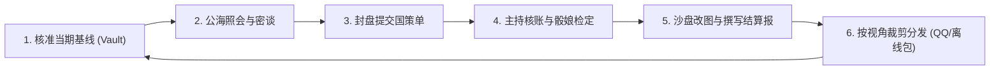

# 中国国内“国策推演文游”深度需求调研与 Wenyou Pro 功能演进方案

> 整理：安钰｜外部社区规则与开源工具生态检索核验截至：`2026-11-25`｜适用工程：`wenyou-pro`

国内的国策推演文游（社群内常称为“群友国策”“架空推演”“拟盘”或“文字战略推演”）是一种依托社交平台运转的多人长周期历史与地缘模拟游戏。它在机制上吸收了三种不同源流的玩法特征：以 19 世纪普鲁士**双盲自由兵棋（Free Kriegsspiel）**为蓝本的裁判黑箱与战争迷雾隔离、以 **Paradox（P 社）大战略游戏**为框架的国家体制与地缘版图博弈，以及结合 **TRPG 跑团**的随机骰点检定和角色扮演叙事。一场典型推演通常由一名主推领衔数位分管裁判组成主持团队（GM / 裁判组），带领十余名到数十名扮演各国元首或内阁成员的玩家，围绕一份不断改写的架空世界史推进数月乃至数年的博弈。

本文结合公开社区规则文档、开源生态检索核验结果，以及 `wenyou-pro` 当前的包结构与契约现状，系统梳理国内国策推演圈从实际运转拓扑到工具链断层与崩局诱因的核心问题，并落出严格守住架构红线的分阶段功能演进设计。

---

## 从贴吧拟盘到 QQ 多群双盲的圈层演进与三大流派

### 圈层演进脉络

国内文字战略推演早期主要扎根于百度贴吧，以架空历史、假想历史与虚拟国家等贴吧以及 P 社系列游戏贴吧为重镇，采用主贴连载与楼层回复的“图文推演 / 拟盘”模式。最初的贴吧推演规则极简，胜负往往取决于玩家在回帖里的论辩文笔和历史考据功底，圈内俗称“口胡对波”。缺乏物质与产能约束的辩论很快暴露出边界不清的问题：落后政权动辄靠精神动员强行逆袭，争吵迅速从局内演变成场外口水战。

为了约束唯心操作，资深主持开始向游戏规则引入经济核算表和疆域地图，逐步分化出两条技术路线。重度考据与算账派将国家财政、人口基数和军工产出做成复杂 Excel 表单，形成“表推”；重度地缘对抗派则借用图像软件、MapChart 或程序化地图工具逐回合涂色改线，形成“图推”。这类实践随后在 Wikidot 平台上的中文“文字战略游戏维基（TBS WIKI）”沉淀为成套规则模板与术语体系，同时吸收了“战争艺术论坛（TOAW）”等兵棋社群的双盲裁决规范。

随着社群主力从贴吧迁移至 QQ 群与 QQ 频道，即时通讯和多人密聊让秘密外交变得高频，但也放大了重度算账的维护成本。纯表推常常在五六轮后因公式失衡或造表人员精疲力竭而停摆，纯自由推又容易在缺乏硬指标时因公正性质疑散伙。目前国内运营最稳、生命周期最长的成熟推演局，大多收敛于**“半表半自由 + 图史双轨”的混合国策流派**：用轻量结构化国情基线约束产能上限，用文字国策承载政治利益交换与战略意图，再由地图和战报锚定每次回合结算的客观结果。

### 三大主流流派特征对照

| 流派名称 | 核心运转逻辑 | 裁判组典型分工 | 玩家每回合输入 | 回合结算产出 | 典型崩盘诱因 |
| :--- | :--- | :--- | :--- | :--- | :--- |
| **表推（硬核数值流）** | 一切国策最终折算为公式与表格里的数值增减，资产负债表不平或资源归零即判定方案无效 | 主推、经济 KP（造表维护财政与工业）、军事 KP（算战损与补给） | 按格式填写资源分配单与量化行动点（AP）指令 | 更新后的各国国力总表、战损明细与简短战况通报 | 表格列数过度膨胀劝退新人；玩家卡公式漏洞刷数据；造表员过劳停更 |
| **图推（地缘沙盘流）** | 以高精度地图涂色与路线标绘作为推演核心，强调地形、海峡、要塞与补给线约束 | 主推、图推美工（涂色改疆域、画战线箭头） | 附带方位与行军目标的军事调动和领土主张说明 | 新一轮着色局势图、战役交火标绘与领土变更公报 | 单机改图工作量过大；跨回合领土变化缺少历史对比；地图大图在聊天流被压缩糊字 |
| **自由推与混合国策流** | 在既定政体、人口和当期技术水准框架内，依靠逻辑推演与关键节点掷骰推进历史演进 | 主推（总控世界线）、分线裁判、外事与史料记录员 | 800～2000 字左右的“抓大放小”国策施政纲领及密谈照会 | 长篇叙事型世界日报、分国结算批复与阶段性条约归档 | 主持遗忘前几轮旧账导致吃书；AI 注水国策增加审稿疲劳；玩家不满主观裁决引发退群 |

### QQ 群五群双盲拓扑与单回合运转闭环

一场讲究信息差（战争迷雾）的中大型 QQ 群国策推演，不会把所有对话塞进同一个群里，通常会裂变成五类功能隔离的群聊或讨论组。

1. **外交公海群（主群）**：承载从公开外交照会、宣战布告到多边会议与日常场外吹水的全部公开对话。这个群信息密度最低也最嘈杂，大量与正史无关的 `ooc` 水群言论混杂在零星的有效声明之间。
2. **正史公告与设定群**：通常开启全员禁言，仅由主持与管理层发布世界观规则书以及每回合的结算战报、公开局势图和双边正式条约（对应 `public` 视角）。
3. **裁判组后台私群**：主推与分管经济、军事的裁判在这里掌握从全球真实兵力部署、潜在国内危机到自然灾害暗骰结果与各国底牌的全局真相（对应 `gm` 视角）。
4. **各国内阁或阵营私群**：成熟推演局常允许大国由多名玩家分别扮演元首、财政大臣和前线总司令共同执政。内阁群既用于成员内部起草尚未定稿的施政草案（`draft`），也用来接收主持单独通报的本国秘密军情与侦察汇报（对应 `faction:<id>` 视角）。
5. **双边或多边密谈讨论组**：玩家临时拉起的秘密会议，用于秘密结盟、军火走私与战后瓜分协议谈判，正式条款往往只在秘密议定书中生效，公海群内则只公布一份毫无火药味的通商协定。

一轮推演的标准闭环如上图所示。只要其中“第 4 步核账”与“第 6 步按视角裁剪分发”依然停留在手工翻聊天记录、手工另存多份文档的阶段，整个局就始终悬在半空中。

---

## 现行拼凑式工具链的六处结构性断层

截至 `2026-11-25` 对中文社区讨论与现有开源辅助工具的核验，国内国策推演圈绝大多数主持人仍在用“QQ 群 + 本地 Word + 腾讯文档 + 灰机 Wiki + Azgaar/MapChart + 海豹骰”这套零散组合维持运转，工具之间的断层直接吞噬了管理层的精力。

### 群文件过期机制与聊天流压缩损耗

QQ 群自带的群文件与聊天记录天然偏向即时消费，难以承担跨数年的世界史料库职能。在非超级会员扩容的普通 QQ 群中，体积较大或长期无人下载的群文件存在平台自动过期清理机制，老回合的国策方案、设定表和高清局势图常常在半年后变为“文件已过期或被清理”。直接通过聊天窗口发送的战区地图，也会被客户端自动压缩画质，一旦玩家重新上传或多次转发，疆域边界与小字标注就模糊到无法辨认。散落在上万条聊天消息中的主持临时口头裁定，随着设备更换或本地缓存清理，往往彻底失去追溯线索。

### 腾讯文档与本地 Word 的权限及版本两难

圈内主持普遍习惯用腾讯文档等在线表格承担“造表”任务，用 Word（`.docx`）收发国策草案与长篇结算。这两种工具各自都有绕不开的缺陷。在线协同表格和文档虽然更新快，却无法在同一个物理文档里做到细粒度的双盲权限隔离：一份刚签署的国际条约如果同时包含公开条款与缔约国秘密附加议定书，主持就必须被迫拆成两份独立文件分开保管；多人共用的大型数值表还时常出现公式被误改，或玩家通过翻看云文档历史修改记录偷窥暗线调整的争议。退回本地 `.docx` 通过私聊点对点收发，则会迅速制造出几十个命名混乱的修订版文件，导致主持自己都分不清哪一版才是最终定稿。

### 灰机 Wiki 等公开维基农场的准入与保密冲突

建立一套词条相互跳转的架空历史百科，是许多长期推演群的核心愿望，灰机 Wiki 也确实托管过部分知名公开文游的世界观词条。但灰机 Wiki 作为面向大众流行文化的商业化维基农场，其建站审核机制明确将个人笔记、小圈子内部站点和缺乏公开受众基础的私人架空世界排除在外，且要求建站申请人账号通常注册满一年、全站有效编辑不少于五百次并完成手机与邮箱认证。

即便主持自行购买云服务器部署 MediaWiki 或 DokuWiki，这类开源软件的默认模型依然面向“公开完结的知识库”。它们不具备按推进时间线动态折叠剧透、按阵营遮蔽暗线情报的能力，也无法一键打成一个可直接上传到 QQ 群文件的免部署离线网页供群友手机离线翻阅。

### Azgaar FMG 与 MapChart 的时空与东方地理短板

MapChart 虽然上手门槛极低，支持《钢铁雄心 4》《维多利亚 3》和现实各洲省份填色，却锁定了固有地理底图，无法服务自建大陆的原创架空世界。因此，具备板块海拔、风向降水与流域气候模拟能力的开源地图工具 Azgaar’s Fantasy Map Generator（FMG）成为架空圈的主力底图生成器，但在国内推演实战中存在四处明显局限。

1. **名称库西方化与汉化迭代滞后**：原版内置的文化与城镇名称生成器高度偏向拉丁语系与西方奇幻，做东方帝国或华夏诸侯割据题材时必须耗费大量精力重配自定义字库；社区汉化版跟进上游版本常有时间差，混用易产生轻微存档兼容风险。
2. **东方核心地理要素表达薄弱**：中文历史与架空推演极看重大江大河治理、京杭式人工运河动脉以及潼关山海关式战略关隘的防守价值。Azgaar 原生河流虽然遵从高程物理规则，对人工运河和关隘要塞体系的精细标注却需要繁琐的手工修整。
3. **缺少时间轴与跨回合变更高亮**：Azgaar 本质上是单时间点地理快照编辑器。推演打到第二十回合后，它无法在同一视图里纵向对比不同年份的疆域盈缩，也不能直观标出“本回合比上一回合新占领了哪几个省份、易手了哪座城池”。
4. **单机存档导致的多端协同割裂**：每次发生割地赔款或新政权独立，都必须由图推美工在本地修改 `.map` 后重新导出静态图发群，地图上的政权与城邦无法直接点击跳转到对应的条约、战报与国情词条。

### 群骰娘检定与正史档案脱钩

以海豹骰（SealDice）为代表的开源 TRPG 骰娘在 QQ 群里已经相当成熟，能够用 `.r 1d100` 或 `.ra` 稳定承担军事奇袭、国内动荡与外交密谋等随机事件检定。问题在于，骰娘输出的检定回执停留在即时聊天流里。两三个回合之后，战报正文里哪怕写明“某年某月海军远征因风暴折损半数”，也很难在一键点击下回溯出当时主持是如何设定检定难度与附加裁定条件，又是实际掷出了多少点。

### GitHub 现有开源文游与推演辅助工具盘点

| 项目名称 | 核心定位 | 技术形态 | 解决的主要问题 | 与 QQ 群真人国策推演的差距 |
| :--- | :--- | :--- | :--- | :--- |
| `Story-to-Game` | 互动剧本生成与单文件 HTML 启动器 | 单 HTML 播放器 + AI 剧本转换技能 | 把大纲转成带条件标记与分支结局的离线小游戏 | 面向单人固定分支阅读，无多国动态地图与多人博弈机制 |
| `MUI Gamebook` | AI 辅助互动小说 DSL 创作与分发平台 | Markdown DSL + 变量系统 + CLI 预览 | 用类似 Markdown 的文本定义属性变量与剧情拓扑 | 侧重单线/多分支视觉小说创作，不支持双盲阵营隔离 |
| `TRPG Agent` | 本地 AI 主持（KP/GM）跑团引擎 | 检定分类器 + 掷骰 + SQLite 硬状态 | 用代码锁死角色数值，防止大模型在 COC 跑团中乱改状态 | 服务“单 AI 当裁判 + 少数角色扮演”，缺少宏观国策与沙盘体系 |
| `CivAgent` | 基于 *Unciv* 的大模型策略玩家代理 | LLM 决策代理对接开源 *文明 5* 复刻版 | 探索 AI 在六角格回合制策略游戏中的外交与军事博弈 | 依托固定电子游戏规则运行，无法承载高自由度文字国策 |
| `MuseAI` / `InkOS` | 世界书、角色卡与长篇网文多智能体管理 | 世界书提取 + 状态摘要记忆 + Web 工作台 | 维护长篇连载与穿书角色扮演的人物设定和伏笔不遗忘 | 聚焦小说与单人 RP 叙事，缺少图史映射与多视角裁剪导出 |

从上表可以看出，开源社区近年涌现的文游与跑团项目几乎全部集中在“让大模型充当主持人陪单个玩家跑剧情”，面向**“真人主持团队裁判、多国玩家双盲对抗并用 QQ 群离线文件完成阶段交付”**的开源图史底座仍处于空白状态。

---

## 推演局高烂尾率的五大病灶与大模型时代的双向冲击

国内国策推演圈公认“十局九鸽”，多数开局热闹的推演群撑不到十个回合便陷入停更或解体。把社区复盘拆开来看，导致推演崩盘的根源集中在以下五个结构性病灶。

### 主持团队查旧账过劳与粗糙结算的恶性循环

一个十二国至二十国规模的推演局，每回合收齐国策动辄上万字。撰写一段文采斐然的世界结算战报其实只消耗了主持不到一半的精力，真正耗干主持热情的，是动笔之前跨群翻找历史旧账的过程。主持必须核对上回合某国私群提交的预算是否留有余地，三轮前签的五年停战协议本轮是否到期，以及此前口头答应某国扩建船坞的先决条件有没有完成。随着回合推进，历史文档与聊天记录呈几何级数堆积，主持一旦遇到现实学业或工作繁忙便很难逐条考据。为了赶在周末前发出结算，主持只能凭记忆做“粗糙结算”，而粗糙结算中哪怕出现一两处对兵力、地形或前期承诺的误判，立刻会引发当事玩家质疑主持“偏心”“钦点”，进而演化成群内大吵、核心成员退坑和全盘停摆。

### 唯心操作、架空地理错位与跨时间线穿帮

玩家侧的高频失误同样直接消耗着裁判组的审核耐心。一类典型问题是脱离当期国情硬指标与执政基本盘利益，在 18 世纪中期强行写出超出工业和财税支撑能力的方案，或是跳过政治利益交换直接强推触动核心军政集团利益的自杀式改革。另一类高频失误发生在架空地图与多支线场景中：架空大陆的海陆相对方位往往与地名用字相反（例如名称带“西”的大陆实际位于本国东海岸隔海相望处），玩家不对照沙盘仅靠印象写海岸防务，极易把舰队派到反方向；当多块大陆按不同流速异步推进时，玩家还常把后期年份才成立的政权国号或条约名称提前写进早期回合的草案中，造成难以挽回的时序穿帮。

### 双盲情报发错群引发的信任崩盘

国策推演最富戏剧性的环节在于暗中合纵连横与战前情报欺骗。但只要主持在桌面端手工维护公开稿、多国密稿和裁判底稿三套版本，发错文件的事故就只是时间问题。一旦一份仍残留 `gm` 暗线批注的 Word 战报、或一张未剔除他国秘密调动标记的沙盘截图误发进公海群，双方布局几个回合的外交暗线当场作废，整局的悬念和博弈基础随之瓦解。

### 后期长文本疲劳与替补玩家接盘断层

推演平稳运行十几个回合后，公告群里的历史战报累计往往达到数万字，新老成员的阅读门槛急剧拉高。原玩家因三次元事务退坑后，主持人好不容易招来一名替补玩家接手该国，新人却面对散落几十个群文件的残缺战报无从入手，既搞不清本国当前有多少常备军与国库负债，也分不清哪些邻国属于暗盟或世仇。缺乏一套即开即读的“单国入坑简报”，导致中期替补玩家留存率极低，最终演变成大量无人接管的“僵尸大国”，拖垮整个地缘生态。

### 大模型普及带来的双向冲击

近两年大语言模型的普及并没有自动拯救国策推演，反而在缺乏工程约束时制造了新的双向内耗。在玩家侧，不少参与者习惯把自己在内阁群的零碎想法直接扔给大模型润色成千字长策，结果交上来的文本充斥着 Markdown 表格与多层嵌套清单，夹杂大量“既……又……”政论空话以及编造的“本国人口逾亿、各州养兵不堪重负”等虚假前提，使主持不得不花更多时间在公文黑话里剔除水分与核查假前提。在主持侧，部分管理尝试直接把全部聊天记录喂给大模型代写结算，却很快遭遇长程“吃书”和因果幻觉：模型可能遗忘两轮前的灭国条约或复活已阵亡将领，甚至无视海峡与山脉阻隔虚构军事进展。圈内实操经验已经印证，**确定性代码与明文索引库必须牢牢掌握硬状态与历史基线，大模型只能作为受限的只读辅助工具参与核账提示，并在人类主持明确批准后才能落盘**。

---

## Wenyou Pro 产品边界校准与分阶段功能演进蓝图

### 现有底座评估与不可逾越的红线

截至当前 `0.1.0-stage0` 阶段，`Wenyou Pro` 已经落定了八个分层明确的包与应用，且整体架构与国内国策推演最难的底层诉求高度契合。其中 `@wenyou/contracts` 冻结了从世界清单、卷宗词条到群聊证据与审稿提案的核心契约；`@wenyou/vault-core` 提供了 Obsidian 兼容的 Frontmatter 解析序列化、防歧义双向链接索引和 `gm / public / faction:<id>` 三级视角过滤；`@wenyou/map-bridge` 与 `@wenyou/export-pack` 实现了基于 RLE 的地图 Delta 去重拆解和 `private/` 物理隔离导出计划；`@wenyou/local-server` 落地了防符号链接/Junction 逃逸的原子写盘以及 `applyPublicOverlay` 孤儿清理，并配合 `maxViewer` 权限钳制与增量索引缓存 `VaultIndexCache`。

接下来的演进设计必须严守仓库既定的四条架构边界，确保底座不被业务需求腐蚀：

1. **只读采集边界**：`packages/qq-ingest` 永远保持只读解析，绝不写回外部聊天数据库或接入任何自动代发 QQ 消息的机器人控制逻辑。
2. **沙盘协议解耦边界**：所有图史档案、国策核账与视角权限逻辑留在 `wenyou-pro` 内部，不侵入外部 `wenyou-pixi-app` 源码，跨仓只通过版本化的 `wenyou-map-bridge/v1` 协议通信。
3. **规则中立边界**：不在内核硬编码特定流派的复杂经济算表公式，保证同一套图史架构同时服务于纯自由推、半表半自由推以及外接 Excel 算账的硬核表推。
4. **人类主权与审稿隔离边界**：任何从群聊导入或外部模型辅助提炼的事实候选，一律先落入 `PendingReviewItem` 待审池，未获真人主持点击批准前绝不混入 `canon` 正史或覆盖本地私有笔记。

### Stage 1：双轨纪年时间轴与沙盘跨回合领土差分

国内架空与多大陆推演常存在“支线时间流速不一致”的现实问题（如北陆战线正打到 1760 年底，群岛海战已推进到 1765 年），同时玩家迫切需要在新一轮开图时一眼看清究竟割让或夺取了哪些地块。

在契约层，可在 `packages/contracts/src/documents.ts` 的 `ChronicleFrontmatter` 中新增可选的全局结算轮次字段 `turn?: number`（非破坏性可选扩展）。支线内部继续保留文字纪年 `era`（维持现有格式如 `"1760年底"`），全局视角下则允许按 `turn` 把跨大陆同期发生的重大事件对齐在同一纵轴上。同时在 `packages/contracts/src/manifest.ts` 的 `EntityMapBinding` 中补充可选的 `markerIds?: readonly string[]`（或区分关隘与航道），补全东方地缘推演极其看重的人工运河、战略关隘与渡口绑定，而不必把整个实体绑定强行塞进 `stateId` 或 `burgIds`。

在地图层，由于 `packages/contracts/src/rle-layer.ts` 已经将每回合战区的 `statesByCell`、`provincesByCell` 压成了紧凑的游程数组 `PackedCellLayerV2`，`packages/map-bridge` 只需新增一个纯函数 `diffSnapshotStates(prevDelta, nextDelta)`，直接双指针扫描相邻两版 RLE 游程即可在毫秒级算出全部归属变化的地块索引、各 `stateId` 的净增减格数以及易手城邦清单，再经 `wenyou-map-bridge` 下发给 `studio-web` 的沙盘叠加渲染差分边框或斜纹高亮。

### Stage 1.5：条约与词条内受限暗线块及导出前泄密预检单

为了解决“同一份国际条约既要发公开正本，又附带仅限两国与主持可见的秘密议定书”的两难，需要把现有的文件级权限下沉一层到块级受控裁剪。

在 `packages/vault-core` 中新增纯函数 `stripRestrictedMarkdownBlocks(body: string, viewer: ViewerScope)`，约定清晰的围栏语法（例如 `:::secret[gm]` 或 `:::secret[faction:aurelia, faction:valen]`）。当 `packages/export-pack/src/plan.ts` 面向非 `gm` 视角生成公开包或 `StandaloneReaderPayload` 时，先对每篇可见文档执行块级剥离，**再对剥离后的可见正文提取 `extractWikiLinks` 与 `extractEmbeddedAssets`**。这样一来，隐藏在 `:::secret[gm]` 块内部的作战草图引用与暗线人物双链会被自动剥夺可见性，不会在 `reader-standalone` 离线包里留下任何残余反链或暗线附件。

对应到前端交互层，`apps/studio-web` 的 `features/export` 在执行离线导出前，应当把 `ExportAuditReport` 渲染成一张强确认的“发包泄密预检单”，明确列出本次导出的目标视角、放行的阵营专属词条与快照数量，以及被物理拦截的 `gm` 暗线、`private/` 私有笔记与他国密档清单，让主持点击导出前心里有底，彻底消除发错群翻车。

### Stage 2 核心减负：主持回合结算与国策同屏核账工作台

这是直接对抗“主持查旧账过劳死”与“AI 注水国策污染审稿”的核心工作台，重点在于把核查成本从“翻十几个文件夹和几千条群聊”压低到“同屏比对”。

1. **静态国策体检器 `lintPolicyDraft`**：在 `packages/vault-core` 中实现纯函数静态扫描，接收玩家提交的国策 Markdown 或纯文本草稿、当前 `VaultIndex` 以及 `{ actorEntityId, branchId, currentOrder }` 上下文。扫描器不依赖外部大模型，直接利用词条库与别名表输出三类精确告警：**跨阵营情报透题预警**（正文命中了 `gm` 或仅对其他阵营可见的实体名与别名）、**跨时间线穿帮预警**（正文引用了首次登场晚于当前 `currentOrder` 的条约或政权名），以及**排版与套话体检**（高亮排查违规表格、缺失关键专名或明显模板化废话）。
2. **双栏同屏核账与提案落库闭环**：在 `apps/studio-web`（经 `apps/local-server` 提供增量读取与原子写盘）构建“国策审稿与结算工作台”。左侧面板高亮渲染玩家提交的国策及静态告警，右侧面板根据当前涉事国自动聚合呈现该国的最新国情卡与现行有效条约，以及关联沙盘位置聚焦按钮和该国近期已标定为 `canon` 的主持群聊裁定原话。主持核对无误后，在右侧直接操作已定义的 `PendingReviewItem` 批复落库：由服务端经 `VaultFs` 原子写入本回合新增 `Chronicle` 卷宗并自动挂接 `sourceRefs`，同时更新相关词条的 `status` 与刷新 `VaultIndexCache`。

### Stage 2：轻量国情抬头卡与替补玩家一键交接包

针对“表推太重、自由推无账可查”与“中期替补新人无从接手”两大社群痛点，在 `packages/contracts/src/documents.ts` 的 `WikiFrontmatter`（当 `category === 'country'` 时）增加可选的结构化 `ledger` 卡片字段，涵盖以下低门槛高信息密度槽位：

- `regime`：当前政体与实际执政基本盘（如君主立宪 / 内阁主导）
- `population`：最新定盘人口规模与主体族群概览
- `military`：常备陆军与主力舰队定盘概数
- `fiscalStatus`：财税健康度定性或关键收支摘要
- `techTier`：当前推演时代已成熟并实际列装的关键技术门槛
- `updatedEra`：上述国情最后一次经主持核定生效的纪年锚点

这套卡片不强制执行自动化经济公式，既能让偏好自由推的主持用自然语言定盘记账，也允许硬核表推主持把外部 Excel 算出的关键结果按回合回填进 Frontmatter。配合该卡片，`packages/export-pack` 与 `apps/reader-standalone` 可增加“阵营交接简报（Faction Handover Pack）”导出预设：主持选中某个需要换人接盘的国家后，一键按 `faction:<id>` 视角打包该国国情抬头卡与历代编年史，连同当前有效明暗条约及本国情报网获知的他国档案，生成一份单文件离线 HTML 发给替补玩家，让新人十分钟内看清家底和外交忌讳。

### Stage 2.5：群聊裁定与海豹骰检定铁证溯源抽屉

为了彻底解决结算公布后围绕“当初明明答应过”“这个概率怎么算出来的”引发的无休止争论，可在 `packages/qq-ingest/src/adapter.ts` 现有斜杠日期与群头衔清洗的基础上，补充对主流 QQ 骰娘（如海豹骰 SealDice / Dice!）标准投掷回执文本的解析，并在 `EvidenceRecord` 的可选元数据中提取结构化检定记录（如投掷表达式 `1d100`、掷出点数与成功等级标签）。

在渲染层，无论是主持端 `apps/studio-web` 还是交付给 QQ 群友的 `apps/reader-standalone` 离线图史馆，都可以将每篇卷宗与词条 Frontmatter 中的 `sourceRefs` 渲染成正文旁可点击展开的“史料铁证脚注”。读者只要点开脚注，就能看到经过当前导出视角脱敏过滤的主持群聊原话与来源频道标签，以及精确到秒的时间戳和当场骰娘检定记录。

### Stage 3 可选扩展：受控边界内的只读核账辅助

在前置确定性图史底座跑顺之后，若需引入大语言模型进一步降低主持工作量，必须在架构上将大模型严格锁定为只读顾问角色：只允许读取经当前视角裁剪后的 `VaultIndex`、`Country Ledger` 与玩家提交的国策文本，输出供人类审阅的矛盾冲突提示或 `PendingReviewItem` 草案建议，绝对禁止模型直接调用 `VaultFs` 篡改正式编年史或地图快照。

---

## 演进路线优先级矩阵

| 演进阶段 | 核心功能模块 | 首要受益角色 | 主要改动仓库包 | 前置工程依赖 |
| :--- | :--- | :--- | :--- | :--- |
| **Stage 1** | 双轨纪年时间轴与 RLE 跨回合领土差分 | 图推美工、主推 GM、全员玩家 | `@wenyou/contracts`, `@wenyou/map-bridge`, `@wenyou/studio-web` | 完成 `wenyou-pixi-app` 沙盘 iframe 实机挂载联调 |
| **Stage 1.5** | 块级 `:::secret` 暗线裁剪与导出泄密预检单 | 主推 GM、阵营密谈玩家 | `@wenyou/vault-core`, `@wenyou/export-pack`, `@wenyou/studio-web` | `studio-web` 接入 `local-server` 导出预览接口 |
| **Stage 2** | 国策同屏核账工作台与 `PendingReviewItem` 闭环 | 主推 GM、分线裁判 | `@wenyou/vault-core`, `@wenyou/local-server`, `@wenyou/studio-web` | 打通服务端原子写盘与索引缓存热刷新端点 |
| **Stage 2** | 轻量国情抬头卡与替补玩家离线交接简报 | 经济 KP、新入坑替补玩家 | `@wenyou/contracts`, `@wenyou/export-pack`, `@wenyou/reader-standalone` | 完成 `reader-standalone` 离线静态单包编译模板 |
| **Stage 2.5** | 海豹骰检定识别与 `sourceRefs` 史料铁证抽屉 | 主推 GM、全员玩家 | `@wenyou/qq-ingest`, `@wenyou/studio-web`, `@wenyou/reader-standalone` | `qq-ingest` 只读 JSON/粘贴导入入口接通前端台面 |
| **Stage 3** | 只读大模型冲突校验与候选摘要辅助 | 主推 GM | `@wenyou/local-server`（只读推理网关适配） | Stage 2 人类批复闸门稳定运行 |

---

## 检索与核验参考来源

1. **中文文游与推演规则社群档案**：Wikidot 中文文字战略游戏维基（TBS WIKI）国策文游规则与游玩指南；百度贴吧架空历史与图文推演生态公开讨论；知乎关于表推经济军事算账模型与文字推演流程讨论。
2. **双盲兵棋与裁判体系**：Free Kriegsspiel（自由兵棋）双盲裁判中转与战后复盘（AAR）机制；中文战争艺术论坛（TOAW）兵棋裁判实践资料。
3. **地图与骰娘工具链一手文档**：Azgaar’s Fantasy Map Generator（FMG）开源架构与 `.map` 快照数据模型；海豹骰（SealDice）官方部署与 `.r` / `.ra` 检定手册。
4. **协同平台与托管边界资料**：灰机 Wiki（HuijiWiki）建站条件与公开内容审核准则；QQ 群文件过期清理与聊天图片压缩机制技术说明。
5. **开源文游与 Agent 状态机参考仓库**：`Shanyin-ai/story-to-game`, `meathill/mui-gamebook`, `Gousting/trpg-agent`, `fuxiAIlab/CivAgent`, `yejiming/MuseAI`, `Narcooo/inkos`。
