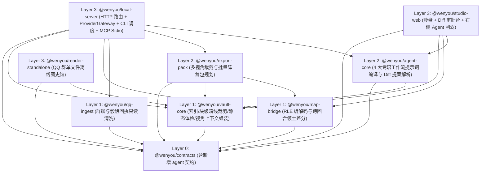

# Wenyou Pro「独立文游 Agent 工作台」立项与架构方案

> 立项整理：安钰｜基线版本：`0.1.0-stage0` → 目标主线：`0.2.0`（Standalone Agent Workbench）｜外部合规检索核验截至：`2026-11-26`

## 1. 立项背景与核心定位升级

国内 QQ 群国策推演与历史架空文游长期受困于两类工具极端：一类是纯手工填表与静态图片涂色的单机百宝箱（无法解决几十回合后的查旧账过劳、跨时间线穿帮与双盲发包泄密）；另一类是脱离确定性世界基线的裸大模型聊天（极易吃书、编造国力前提或越权篡改档案）。

本项目正式将 **Wenyou Pro** 立项升级为 **「独立文游 Agent 工作台（Standalone Wenyou Agent Workbench）」**：
以现有的 Obsidian 兼容明文图史档案库（`@wenyou/vault-core`）与程序化沙盘桥（`@wenyou/map-bridge`）为确定性硬底座，参考 `T3 Code` 的 **「多通道模型控制面 + 受控 Diff 人类审批台（Supervised Approvals）」** 范式，打造一套既可作为独立桌面/本地 Web 产品分发给普通推演主持与玩家，又能通过内置 MCP Server 无缝接入极客 IDE（如 Antigravity）的一体化图史推演工作台。

### 核心产品主张

1. **三通道模型底座（零中转抽成、零逆向封号风险）**：
   - **通道 A — 标准 BYOK API 直连（主力普适通道）**：原生流式支持任意 OpenAI 兼容接口（DeepSeek、火山方舟豆包、硅基流动、阿里百炼 Qwen、OpenRouter 等）及 Gemini / Anthropic 官方 API Key。
   - **通道 B — 本机官方 CLI 订阅挂接（`T3 Code` 同源控制面）**：自动探测本机已安装并完成官方登录的原装 CLI（`codex`、`claude`、`gemini`），通过非交互标准流子进程调度，合法复用用户既有订阅额度。
   - **通道 C — 原生 MCP Server 双栖保留**：同一后端进程支持以 `--mcp`（stdio）模式挂载至 Antigravity 或其他支持 MCP 的客户端，共享同一套明文 Vault 与待审池。
2. **模型只有「提案权」，界面握紧「落锤权」**：
   - 大模型与外部 CLI 永远只能读取经当前 `ViewerScope`（`gm / public / faction:<id>`）裁剪后的上下文包，且只能产出结构化的待审提案（`DiffPatchProposal` / `PendingReviewItem`）。
   - 一切对 `chronicle/`、`wiki/` 与 `manifest.json` 的正式修改，必须在工作台的 **「审稿与 Diff 审批台」** 经人类点击批准后，方由服务端 `VaultFs` 原子落盘。
3. **主持端重装增效，群友端零门槛离线消费**：
   - 主持与参谋在本地工作台享受「沙盘联动 + Agent 核账 + 泄密预检」；分发给 QQ 群友的产物依然是 `apps/reader-standalone` 编译出的单文件离线 HTML 图史包与 `.docx` 正式文书，群友无需安装任何运行环境。

---

## 2. 外部订阅接入合规与安全红线

结合截至 `2026-11-26` 对主流模型厂商服务条款与第三方客户端风控策略的核验，立项确立以下四条硬红线：

1. **严禁逆向提取或伪装消费者订阅凭证**：绝不读取浏览器 Cookie、绝不提取第三方私有 OAuth Token 自行拼装伪造请求头（规避 Anthropic 等厂商针对非官方套壳直连消费者订阅的封号风控）。订阅复用严格限定为调用用户本机已安装的**官方原装 CLI 二进制**。
2. **CLI 子进程物理只读沙箱**：调度本机 `codex` / `claude` / `gemini` CLI 时，工作目录必须指向系统临时空目录或只读快照副本，显式关闭其直接写文件的自动执行权限（如不使用危险越权写盘标志），严禁外部 CLI 绕过 `VaultFs` 直接触碰 `<vault>` 目录。
3. **API 凭据与世界存档物理分离**：用户的 BYOK API Key 严禁写入 `<vault>` 目录、导出包或仓库配置文件，统一存放于用户本机配置目录 `~/.wenyou-pro/providers.json`（仅本机当前用户可读写）或进程环境变量；后端 `/api/providers` 接口向前端返回状态时必须脱敏掩码（仅保留末 4 位），且日志严禁打印明文密钥。
4. **视角上限强钳制（`maxViewer` Hard Clamp）**：无论前端请求还是 Agent 工具调用，实际组装的上下文包均受服务端 `maxViewer` 硬边界钳制。当玩家以 `maxViewer = faction:<本国>` 启动参谋模式时，Agent 在物理层面无法读取 `<vault>/private/`、`gm` 暗线或其他阵营密档。

---

## 3. 架构演进与模块职责（严格遵守单向 DAG）

在保留现有 Stage 0 五个核心包零破坏的前提下，新增纯领域包 `@wenyou/agent-core`，并在 `apps/local-server` 与 `apps/studio-web` 完成宿主层与产品界面闭环：

### 各层新增职责明细

1. **`@wenyou/contracts`（零运行时依赖）**：
   - 新增 `src/agent.ts`：定义 `AgentProviderKind`（`byok-openai` / `byok-anthropic` / `byok-gemini` / `cli-codex` / `cli-claude` / `cli-gemini`）、`AgentWorkflowId`、流式事件 `AgentRunEvent` 以及待审补丁契约 `DiffPatchProposal`。
   - 向前兼容扩展 `ChronicleFrontmatter.turn`（全局结算轮次）与国家词条 `WikiFrontmatter.ledger`（轻量国情抬头卡）。
2. **`@wenyou/vault-core`（纯 TS 确定性内核）**：
   - `stripRestrictedMarkdownBlocks`：按 `ViewerScope` 剥离 `:::secret[...]` 受限暗线块，阻断暗线内部双链与附件外泄。
   - `lintPolicyDraft`：零大模型依赖的静态国策体检（跨阵营透题告警、跨时间线穿帮告警、违规表格与公文套话高亮）。
   - `buildScopedContextPack`：按目标实体、当前支线与 `ViewerScope` 自动聚合并裁剪喂给 Agent 的上下文包，附带明确的引用清单供前端透明展示。
3. **`@wenyou/agent-core`（新增纯 TS 编排包，禁 `node:*` / DOM / `pixi.js`）**：
   - 固化四大垂直文游工作流的输入契约、角色约束与结构化输出解析器，杜绝泛化闲聊跑偏：
     1. **`ingest_triage`（洗群聊提证据）**：从导入的 QQ 聊天记录中剔除水群 `ooc`，提炼外交照会、主持口头裁定与骰娘检定候选；
     2. **`policy_audit`（审国策核旧账）**：结合静态体检结果、涉事国 `ledger` 国情卡、现行条约与近期裁定，输出逐条核账批注与风险提示；
     3. **`chronicle_draft`（写结算与演化档案）**：依据本轮核准动作生成新增 `Chronicle` 编年史草稿、词条状态变更与条约暗线块 `DiffPatchProposal`；
     4. **`faction_advisor`（阵营参谋写国策）**：在 `faction:<id>` 视角隔离下，仅依据本国已知情报与“抓大放小、去 AI 味、禁表格套话”铁律起草施政纲领。
4. **`@wenyou/local-server`（统一本地后端 + MCP 双模入口）**：
   - **HTTP API 与 SSE 流**：提供 Vault 读写、待审提案队列管理（`/api/proposals`）、Provider 配置与健康探测（`/api/providers`）、以及 Agent 工作流流式执行端点（`POST /api/agent/runs`）。
   - **`ProviderGateway`**：统一封装原生 `fetch` BYOK 流式客户端（OpenAI 兼容 / Anthropic / Gemini）与本机官方 CLI 子进程运行器（支持 `AbortController` 随时中断）。
   - **内置 MCP Stdio 入口（`src/mcp-stdio.ts`）**：复用同一套 `VaultFs` 与 `VaultIndexCache`，向 Antigravity 或外部宿主暴露只读检索、静态体检与提交待审提案工具。
5. **`@wenyou/studio-web`（独立产品工作台界面）**：
   - 遵循浅层级视觉密度规范（容器嵌套 ≤3 层，低频密钥配置收进二级抽屉）：
     - **顶栏（Context & Provider Bar）**：世界标题、当前生效视角切换器（`GM 全局` / `公开` / `指定阵营`）、模型通道胶囊（一键切换已配置的 BYOK 模型或本机已就绪 CLI）。
     - **左中主舞台（Main Workbench）**：四视图切换——`图史沙盘`（`wenyou-pixi-app` 桥接与跨回合疆域差分）、`审稿与 Diff 台`（国策体检对照 + 待审 `DiffPatchProposal` 左右比对批准/驳回）、`编年史与词条`、`发包与泄密预检`。
     - **右侧副驾栏（Agent Copilot Dock）**：四大专职工作流快捷入口、本次投喂给模型的透明上下文胶囊（点开可看模型到底读了哪几篇文档）、流式输出与一键转入待审台。

---

## 4. 分阶段实施里程碑

| 阶段 | 里程碑目标 | 关键交付物 | 验收门槛 |
| :--- | :--- | :--- | :--- |
| **Phase 1** | **Agent 运行时底座与 BYOK + MCP 双通** | `@wenyou/contracts`（`agent.ts`）、`@wenyou/vault-core`（静态体检 + 块级裁剪 + 视角上下文包）、`@wenyou/agent-core`、`local-server`（BYOK 流式网关 + 凭据掩码存储 + 待审队列 API + `--mcp` 入口） | `npm run check` 全绿；单测覆盖密钥脱敏、`maxViewer` 越权拦截、提案未批准不改盘、MCP 协议读写闭环 |
| **Phase 2** | **本机官方 CLI 订阅挂接器** | `local-server` 内 `CliHarnessRunner`（`codex` / `claude` / `gemini` 本机探测、临时只读目录隔离、标准流解析与中断回收） | 模拟与本机实装 CLI 双重验证：未登录/未安装优雅降级报错，运行期 `<vault>` 零直接写盘痕迹 |
| **Phase 3** | **`studio-web` 产品工作台与 Diff 审批闭环** | 顶栏视角/模型切换器、右侧四大工作流副驾栏、主舞台国策核账与 Unified Diff 批准落盘台、导出前泄密预检单 | 独立 Chromium 实机联调截图核验（空态/流式运行态/Diff 审批落盘态/报错态），容器嵌套 ≤3 层 |
| **Phase 4** | **沙盘跨回合差分与离线群友包升级** | `map-bridge` RLE 跨回合领土差分联动 `wenyou-pixi-app`、`reader-standalone` 移动端阅读优化 + 史料铁证抽屉 + 一键批量导出全阵营离线包 | 黄金夹具端到端导出零泄漏校验 + 独立 Chromium 沙盘与离线单页 HTML 实机交互验证 |
