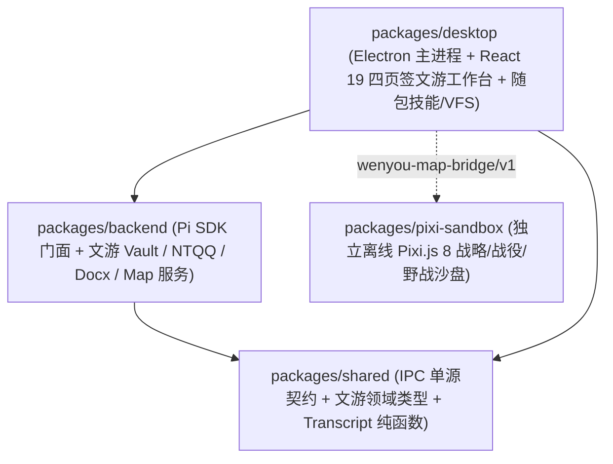

# Wenyou Pro「独立文游 Agent 工作台」立项与架构方案

> 立项整理：安钰｜架构主线：`v0.2.x`（基于 Percho + Pi SDK 的独立桌面工作台）

## 1. 立项背景与核心定位

国内 QQ 群国策推演与历史架空文游长期受困于两类工具极端：一类是纯手工填表与静态图片涂色的单机组合（几十回合后极易因查旧账过劳与时间线穿帮崩局）；另一类是脱离确定性世界基线的裸大模型聊天（极易遗忘前轮裁定、编造兵力国力前提或与真实群聊记录脱节）。

**司命 · 文游 Pro（Wenyou Pro）** 定位为 **「独立文游 Agent 桌面工作台（Standalone Wenyou Agent Workbench）」**：
以本地明文世界存档目录（Vault）、零拷贝只读 QQ 群聊采集与内置离线 Pixi 动态沙盘为确定性硬底座，基于 `Jaxton07/percho`（MIT）与 `@earendil-works/pi-coding-agent`（Pi SDK）打造一体化图史推演桌面端。

### 核心产品主张

1. **多通道模型底座（零中转抽成、合规接入）**：
   - **BYOK API 直连**：原生流式支持 DeepSeek、Google Gemini、Anthropic、OpenAI、火山方舟、硅基流动、阿里百炼及自定义中转站 Base URL。
   - **官方 OAuth 订阅登录**：复用 SDK 内置官方登录流程接入支持的订阅账号，绝不逆向提取浏览器 Cookie。
   - **MCP 与用户自定义 `.md` 子代理**：支持挂载外部 MCP Server，并按需加载用户或项目目录下的自定义 `.md` 子代理，不在引擎内硬编码固定文游子代理。
2. **L0 / L1 / L2 三层图史记忆与原文溯源**：
   - **L0 原始证据库（`.wenyou/evidence.jsonl` + `cursors.json`）**：通过 Windows 零拷贝只读 NTQQ VFS 或跨平台离线 `.txt` / `.json` 导入群聊，维护双增量游标防重报，支持最高 20,000 条长程传话溯源与前后文抽屉回看。
   - **L1 局势简报与滚动台账（`02-局势简报与台账/`）**：自动归纳三段式局势简报与跨群台账，未定案讨论标注 `[未定案草案]`，所有重要论断附带可点击 `[sourceId]` 引用。
   - **L2 设定实册与编年史（`01-设定与国力实册/`、`04-编年史与条约/`）**：Agent 可直接读写维护世界观档案，右侧工作台「设定与编年史」页签提供清爽只读速览。
3. **宋体自然段原生 `.docx` 书案 + 离线 Pixi 动态沙盘**：
   - 随包写作技能软性引导平实自然段国策风格，通过零外部依赖原生 OpenXML 生成器直接落盘标准宋体自然段 `.docx`（文档作者默认留空，支持可选 `author` 参数），不以硬编码静态门禁卡死正常创作。
   - 通过 `wenyou-sandbox://` 协议离线直载 Pixi.js 8 动态沙盘（并兼容本机/局域网 `http(s)` 源），按工作区哈希物理隔离 IndexedDB，支持 FMG `.map` 与静态图片六角格战区、ORBAT 编制树、团级战役展开与双期态势图对比。

---

## 2. 合规与本地数据安全边界

1. **只读采集边界**：本机 NTQQ 页级只读 VFS 绝不修改或锁死 QQ 原始数据库，也绝不代发任何 QQ 消息；macOS / Linux 推荐离线放入 `.txt` / `.json` 聊天记录。
2. **凭据与世界存档物理分离**：模型 API Key 与登录凭据统一保存在用户本机隔离目录 `~/.wenyou-pro/agent/` 下，绝不写入任何世界存档目录或源码仓库。
3. **工作区路径护栏**：`packages/backend/src/wenyou/vault-paths.ts` 与 `wenyou-asset://vault` 协议严格执行 `realpath` 路径穿越防护，拒绝越界路径及经协议直读 `private/`、`.wenyou/`。
4. **轻量化打包与防开盒门禁**：发布管线仅将主进程运行时依赖打入 `app.asar`，打包钩子裁剪 `locales/` 仅留 `zh-CN.pak` 与 `en-US.pak`；仓库提交与验包全链路执行本机路径脱敏扫描。

---

## 3. 四包单向架构与模块职责

### 各包核心职责

1. **`packages/shared`（零 Node / Electron / React 依赖）**：
   - `ipc-channels.ts` / `ipc.ts`：单源 IPC 契约表，自动派生 `PiApi` 与 preload 接口。
   - `wenyou.ts`：定义 `WENYOU_STANDARD_DIRS`、`WorldManifest`、`SituationBriefing`、`PolicyArtifact`、`MapInspectResult`、`NtqqStatusSnapshot`、`WenyouCanvasEvent` 等核心类型。
2. **`packages/backend`（纯 Node 引擎与文游领域服务）**：
   - `wenyou/service.ts`：Vault 初始化、工作区概览聚合、L1 局势简报与台账发布、国策 `.docx` 落盘、设定与编年史索引与读取。
   - `wenyou/extension.ts`：注册 8 个 `wenyou_*` 工具（`wenyou_init_campaign`、`wenyou_pull_qq`、`wenyou_lookup_source`、`wenyou_read_memory`、`wenyou_publish_briefing`、`wenyou_write_policy_docx`、`wenyou_open_maps`、`wenyou_inspect_map`）并注入世界上下文。
   - `wenyou/vault-paths.ts`：工作区路径规范化、`realpath` 防穿越校验与 Frontmatter 解析。
   - `wenyou/docx-builder.ts`：纯 TypeScript 零依赖宋体自然段 OpenXML `.docx` 生成器。
   - `wenyou/qq-ingest.ts` & `wenyou/ntqq-sync.ts`：跨平台群聊解析、L0 证据归档、双游标防重报与本机 NTQQ 同步调度。
   - `wenyou/map-state.ts`：FMG `.map` 与 `wenyou-project` 沙盘工程解析、编制兵力统计与双期态势对比。
3. **`packages/desktop`（Electron 桌面工作台）**：
   - **主进程**：`wenyou-protocol.ts`（`wenyou-asset://` 与 `wenyou-sandbox://`）、`wenyou-sandbox-probe.ts`、`wenyou-world-dir.ts`、`ipc/wenyou.ts` 及 `scripts/after-pack.cjs` 语言包裁剪钩子。
   - **右侧动态画布（`WenyouCanvas.tsx`）四页签**：
     - **Tab 1 — 局势简报（`BriefingPanel.tsx` + `SourceContextDrawer.tsx`）**：三段式 L1 局势综述、滚动台账与 `[sourceId]` 原文上下文溯源抽屉。
     - **Tab 2 — 国策书案（`PolicyDeskPanel.tsx`）**：已归档国策的宋体纸面只读预览、`.docx` 另存为与一键唤起 Agent 起草本轮国策。
     - **Tab 3 — 沙盘与图集（`AtlasComparePanel.tsx`）**：按 `?workspace=<cwd>` 隔离嵌入内置 Pixi 沙盘，并提供双期态势图单图/双屏/卷帘缩放对比。
     - **Tab 4 — 设定与编年史（`ProposalsExportPanel.tsx`）**：纯只读浏览 `01-设定与国力实册/` 与 `04-编年史与条约/` 档案正文。
4. **`packages/pixi-sandbox`（内置离线动态推演沙盘）**：
   - 支持 FMG `.map` 与静态图片六角格战区、政权/省份涂刷联动城池归属、ORBAT 编队树、团级战役展开与独立野战窗口；经 `wenyou-map-bridge/v1` 协议与宿主双向同步工程存档与实体选中。

---

## 4. 质量与发布验收基线

- **防开盒路径门禁**：`npm run check:paths` 拦截任意硬编码本机用户路径与工作区盘符。
- **云端防锁死校验**：`npm run repo:guard` 静态验证 `CODEOWNERS`、CI 超时与并发取消及归档工作流触发边界。
- **全仓类型与测试闭环**：`npm run typecheck`、`npm --prefix packages/pixi-sandbox run test`、`node --test scripts/wenyou-release/*.test.mjs` 与 Vitest 工作区单测。
- **跨平台打包与闭环验包**：`scripts/wenyou-release/build-installer.mjs` 与 `verify-package.mjs` 校验 Windows / macOS 产物的 SHA256、`app.asar` 精简依赖闭包、语言包裁剪及路径脱敏。
